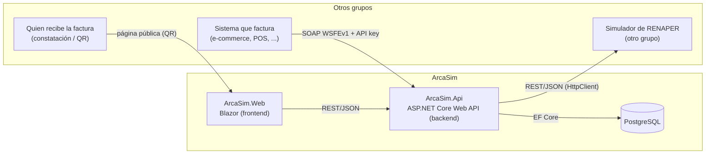
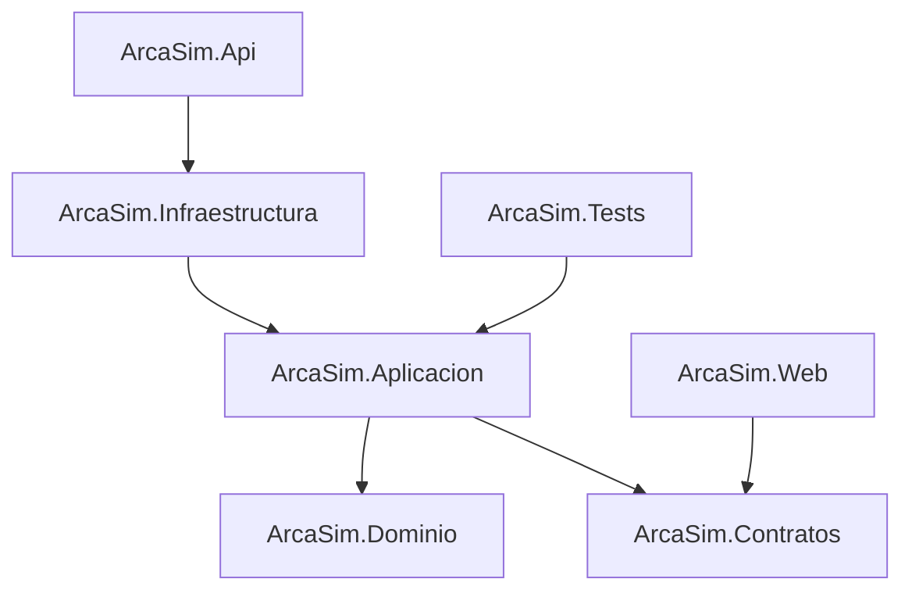

# ArcaSim: simulador de ARCA

Trabajo Final Integrador de **Programación de Aplicaciones Distribuidas** (UTN).

Este repositorio es la **base del proyecto**: tiene la estructura de carpetas, los proyectos
creados y conectados entre sí, y la base de datos lista para usar. La lógica todavía no está
implementada

---

## Integrantes

| Integrante | Legajo | Email | Usuario de GitHub | Rol (ver [§8](#8-división-del-trabajo)) |
|---|---|---|---|---|
| Rodrigo Martín Ordoñez Nadra | 58366 | Rodrigo.OrdonezNadra@alu.frt.utn.edu.ar | RodriGB0510 | Rol 1 |
| _Nombre y apellido_ | | | | |
| _Nombre y apellido_ | | | | |
| _Nombre y apellido_ | | | | |

---

## 1. Qué hay que hacer

**Nuestro proyecto:** una aplicación web que cumpla las tareas de **ARCA** (ex AFIP) en la
factura electrónica:

> Recibe la información de la factura a emitir y devuelve un código (**CAE**) que permite validar
> la factura.

**Integración con otros grupos:**

- **Nos consumen:** los sistemas de otros grupos que necesiten facturar (un e-commerce, un punto
  de venta, etc.) llaman a nuestros **web services SOAP**, iguales a los de ARCA, para obtener el
  CAE de sus facturas. Cualquiera puede además verificar una factura con nuestro servicio de
  constatación.
- **Consumimos:** otro grupo hace una simulación de **RENAPER** (Registro Nacional de las
  Personas). La usamos para validar la identidad de las personas que se registran como
  contribuyentes y de los receptores de facturas identificados con DNI.

---

## 2. Cómo funciona en la realidad (resumen)

### ARCA: factura electrónica

ARCA ofrece **web services SOAP** a los sistemas de los contribuyentes:

1. **Alta (una sola vez):** con Clave Fiscal, el contribuyente obtiene un **certificado digital**,
   lo asocia al servicio de factura electrónica (`wsfe`) y crea un **punto de venta**.
2. **Autenticación (WSAA):** el sistema firma un pedido con su certificado y recibe un **Ticket de
   Acceso** (token + sign) válido por 12 horas.
3. **Autorización (WSFEv1):**
   - `FECompUltimoAutorizado`: devuelve el último número de comprobante autorizado para ese
     punto de venta y tipo. La numeración debe ser **correlativa**.
   - `FECAESolicitar`: recibe los datos de la factura (tipo, punto de venta, número, fecha,
     receptor, importes, IVA, moneda). Valida todo y responde:
     - **Resultado** `A` (aprobado) o `R` (rechazado), con códigos de error u observaciones.
     - **CAE**: Código de Autorización Electrónico de 14 dígitos.
     - **Vencimiento del CAE.**
4. **Impresión:** la factura lleva el CAE, su vencimiento y un **código QR** que apunta a ARCA
   con los datos del comprobante.
5. **Constatación:** quien recibe la factura (o cualquier tercero) puede verificar en ARCA que el
   comprobante y su CAE son válidos.

Algunas reglas que valida ARCA:

- El total debe ser igual a la suma de neto, IVA, exento y tributos.
- Un Responsable Inscripto emite facturas **A** (a otros inscriptos o monotributistas) o **B** (a
  consumidores finales). Un Monotributista emite facturas **C**, que no discriminan IVA.
- La factura A exige la CUIT del receptor.
- Se debe informar la condición frente al IVA del receptor (RG 5616).
- La fecha debe estar dentro de un rango cercano al día de emisión.

Manual de referencia: *Manual para el desarrollador – Facturación RG 4291 (WSFEv1)*, en el sitio
de ARCA.

### RENAPER e identificación de personas

El **RENAPER** es el registro de identidad de las personas (DNI). En la realidad, la **CUIT/CUIL**
de una persona humana se forma con un prefijo (20, 23, 24 o 27), su **número de DNI** y un **dígito
verificador**. Por eso, para dar de alta a una persona como contribuyente o identificar a un
receptor por DNI, primero se valida que la persona exista en el registro de identidad.

---

## 3. Alcance propuesto

**Mínimo (MVP):**

1. **Contribuyentes y puntos de venta:** alta de emisores. Las personas humanas se validan contra
   **RENAPER** (DNI → nombre y apellido) y se les calcula o valida la CUIT.
2. **Web service SOAP WSFEv1 igual al de ARCA** (mismo WSDL, namespace, operaciones y nombres de
   campos): `FEDummy` (ya implementado), `FECompUltimoAutorizado`, `FECAESolicitar`,
   `FECompConsultar` y algunos `FEParamGet*` (tablas de tipos de comprobante, IVA, etc.).
3. **Autenticación simple con API key:** cada contribuyente genera su API key en el portal y la
   envía en el objeto `Auth` de cada llamada (ver [Cómo se integra otro grupo](#cómo-se-integra-otro-grupo)).
   Como quienes se integran son estudiantes, se deja para más adelante el mecanismo real de ARCA
   (certificados, CMS, Ticket de Acceso).
4. **Autorizar comprobante:** valida reglas de ARCA (numeración correlativa, totales, IVA, tipo de
   comprobante según la condición del emisor y del receptor) y devuelve **CAE + vencimiento** o
   los errores, con los mismos códigos que ARCA.
5. **Consultas:** último número autorizado y datos de un comprobante emitido.
6. **Constatación pública:** verificar un comprobante por sus datos o por su **código QR**.
7. **Portal web:** alta de contribuyentes, generación de la API key, emitir comprobantes a mano,
   listarlos y constatarlos.
8. **Facilidades para los otros grupos:**
   - Valores por defecto para los campos opcionales (moneda `PES`, cotización 1, fecha de hoy).
   - Un ejemplo de "pedido mínimo" documentado.
   - Ejemplos listos en `docs/`: XML para Postman o SoapUI, y código en C#, Python (`zeep`) y
     Node.js (`soap`).
   - Mensajes de error claros: el mismo código de ARCA más un texto que explique qué corregir.

**A futuro (opcional):**

- **Autenticación igual a ARCA (WSAA):** el portal emite un certificado X.509 a partir de un CSR;
  el sistema cliente firma el pedido de acceso (CMS) y llama a `loginCms`, que devuelve un Ticket
  de Acceso (token + sign) válido por 12 horas. Convive con la API key, así que no rompe a nadie.
- Despliegue en la nube, notificaciones a otros sistemas cuando se emite un CAE, PDF con QR.

---

## 4. Arquitectura



- **Frontend (`ArcaSim.Web`):** portal web en Blazor. No accede a la base: todo pasa por la API.
- **Backend (`ArcaSim.Api`):** tiene **dos interfaces sobre la misma lógica**:
  - **SOAP** (`Soap/`): el web service WSFEv1, igual al de ARCA (y a futuro el WSAA). Es lo que
    usan los sistemas de otros grupos.
  - **REST** (`Controllers/`): lo que usa el portal (alta de contribuyentes, listados, emisión
    manual, constatación).

  Ambas interfaces son "adaptadores" delgados: traducen el formato y llaman a los mismos
  servicios de `ArcaSim.Aplicacion`, así las validaciones son idénticas por cualquier canal.
- **Base de datos:** PostgreSQL, con acceso mediante Entity Framework Core.
- **RENAPER (externo):** servicio de otro grupo. Se consume por HTTP detrás de una interfaz
  (`IRenaperCliente`), así podemos usar una implementación falsa (*stub*) mientras el servicio
  del otro grupo no esté disponible.

### Cómo se integra otro grupo

1. En el **portal**, dar de alta su contribuyente (CUIT ficticia) y un punto de venta.
2. En el portal, **generar la API key** de ese contribuyente y guardarla en la configuración de su
   sistema. Es un secreto: se usa desde su **backend**, nunca desde el navegador.
3. Llamar a `FECompUltimoAutorizado` para saber el próximo número de comprobante.
4. Llamar a `FECAESolicitar` con los datos de la factura → recibe el **CAE** y su vencimiento.

La API key viaja en el **mismo objeto `Auth` que usa ARCA**, en el lugar del token:

```xml
<ar:Auth>
  <ar:Token>API_KEY_GENERADA_EN_EL_PORTAL</ar:Token>
  <ar:Sign></ar:Sign>                <!-- vacío mientras se use API key -->
  <ar:Cuit>30712345671</ar:Cuit>     <!-- CUIT del emisor -->
</ar:Auth>
```

Por qué en `Auth` y no en un header HTTP: el contrato SOAP queda **idéntico al de ARCA**. Cuando se
agregue el WSAA, los otros grupos no tienen que cambiar sus llamadas a WSFEv1: solo cambia de
dónde sacan el `Token` y el `Sign`. El servidor puede aceptar los dos modos a la vez: con `Sign`
vacío valida la API key; con `Sign`, valida el Ticket de Acceso del WSAA.

Errores de autenticación (mismos códigos que ARCA): **600** si la API key no es válida o fue
revocada, y **601** si la CUIT del `Auth` no corresponde a esa API key.

### Integración con RENAPER (a acordar con el otro grupo)

Lo que necesitamos de su servicio, como mínimo:

| Operación | Entrada | Salida esperada |
|---|---|---|
| Consultar persona | DNI (y sexo, si lo requieren) | Existe sí/no, nombre, apellido, fecha de nacimiento, si falleció |

La URL se configura en `src/ArcaSim.Api/appsettings.Development.json` → `Renaper:UrlBase`.
El formato exacto (rutas, JSON, autenticación) hay que acordarlo con ese grupo y documentarlo en
`docs/`.

---

## 5. Tecnologías

| Uso | Tecnología |
|---|---|
| Lenguaje y plataforma | C# / **.NET 10** |
| Backend | **ASP.NET Core Web API** (controllers) |
| Web services SOAP (como ARCA) | **SoapCore** (WSDL en `/wsfev1/service.asmx?wsdl`) |
| Documentación de la API REST | OpenAPI + **Scalar** (`/scalar`) |
| Autenticación | API key (se guarda solo su hash). A futuro, WSAA con `System.Security.Cryptography` (X.509, CMS/PKCS#7) |
| Frontend | **Blazor Web App** (render interactivo en el servidor) |
| Acceso a datos | **Entity Framework Core 10** + **Npgsql** |
| Base de datos | **PostgreSQL 17** (en Docker para desarrollo) |
| Integración con RENAPER | `HttpClient` (REST/JSON) |
| Tests | **xUnit** |
| Contenedores | **Docker / Docker Compose** |
| Control de versiones | Git + GitHub |

---

## 6. Estructura del proyecto

```
TFI-base/
├── ArcaSim.slnx                     Solución (Visual Studio 2026 / dotnet CLI)
├── docker-compose.yml               PostgreSQL para desarrollo
├── docs/                            Diagramas, contrato con RENAPER, decisiones
├── src/
│   ├── ArcaSim.Dominio/             Núcleo del negocio (sin dependencias)
│   │   ├── Entidades/               Comprobante, PuntoVenta, Contribuyente, ...
│   │   ├── Enums/                   TipoComprobante, CondicionIva, Concepto, ...
│   │   └── Reglas/                  Validaciones de ARCA (totales, numeración, IVA, CUIT)
│   ├── ArcaSim.Aplicacion/          Casos de uso
│   │   ├── Interfaces/              Repositorios, IRenaperCliente, ... (contratos que implementa Infraestructura)
│   │   └── Servicios/               AutorizarComprobante, ConsultarComprobante, Constatar, ...
│   ├── ArcaSim.Infraestructura/     Implementaciones técnicas
│   │   ├── Persistencia/            AppDbContext (EF Core + PostgreSQL)
│   │   │   ├── Configuraciones/     Mapeo de entidades a tablas
│   │   │   └── Migraciones/         Migraciones de EF Core
│   │   ├── Repositorios/            Implementación de los repositorios
│   │   ├── Integraciones/Renaper/   Cliente HTTP del servicio de RENAPER (+ stub)
│   │   ├── Seguridad/               API keys, generación de CAE (a futuro: certificados del WSAA)
│   │   └── DependencyInjection.cs   Registro de servicios
│   ├── ArcaSim.Contratos/           DTOs JSON de la API REST (los usa también el frontend)
│   │   ├── Requests/
│   │   └── Responses/
│   ├── ArcaSim.Api/                 Backend
│   │   ├── Soap/
│   │   │   ├── Wsaa/                A futuro: loginCms (Ticket de Acceso)
│   │   │   └── Wsfev1/              IServiceSoap (contrato igual al de ARCA) + ServiceSoap
│   │   ├── Controllers/             API REST para el portal (EstadoController de ejemplo)
│   │   └── Program.cs
│   └── ArcaSim.Web/                 Frontend Blazor: Components/Pages, Servicios/ (cliente de la API)
└── tests/
    └── ArcaSim.Tests/               Tests unitarios (Dominio/, Aplicacion/)
```

Dependencias entre proyectos (cada capa solo conoce a las de adentro):



### Web services SOAP (para otros grupos, iguales a ARCA)

| Servicio | Ruta | Operación | Estado |
|---|---|---|---|
| WSFEv1 | `/wsfev1/service.asmx` | `FEDummy`: estado del servicio | **Implementado** |
| WSFEv1 | `/wsfev1/service.asmx` | `FECompUltimoAutorizado`: último número autorizado | A implementar |
| WSFEv1 | `/wsfev1/service.asmx` | `FECAESolicitar`: autorizar comprobante → CAE | A implementar |
| WSFEv1 | `/wsfev1/service.asmx` | `FECompConsultar`: consultar un comprobante | A implementar |
| WSFEv1 | `/wsfev1/service.asmx` | `FEParamGetTiposCbte`, `FEParamGetTiposIva`, `FEParamGetCondicionIvaReceptor`, ... | A implementar |
| WSAA | `/ws/services/LoginCms` | `loginCms`: Ticket de Acceso (token + sign) | A futuro (opcional) |

El WSDL se obtiene agregando `?wsdl` a la ruta. Los contratos (nombres de elementos, tipos,
códigos de error) se copian del *Manual del desarrollador WSFEv1* de ARCA. Todas las operaciones
salvo `FEDummy` reciben el objeto `Auth` con la API key.

### API REST (para el portal)

| Método | Ruta | Descripción |
|---|---|---|
| GET | `/api/estado` | Estado del servicio (**implementado**) |
| POST | `/api/contribuyentes` | Alta de contribuyente (persona humana validada con RENAPER) |
| POST | `/api/contribuyentes/{cuit}/puntos-venta` | Alta de punto de venta |
| POST | `/api/contribuyentes/{cuit}/api-key` | Generar o regenerar la API key (se muestra una sola vez) |
| GET | `/api/comprobantes?cuit=` | Listar comprobantes de un emisor |
| POST | `/api/comprobantes` | Emisión manual desde el portal → CAE |
| POST | `/api/constatacion` | Verificar un comprobante (público) |

### Modelo de datos inicial (propuesto)

| Tabla | Contenido principal |
|---|---|
| `Contribuyentes` | CUIT, nombre o razón social, tipo de persona, condición frente al IVA |
| `ApiKeys` | CUIT, **hash** de la API key (nunca la clave en texto plano), fecha de creación, revocada sí/no |
| `PuntosVenta` | CUIT, número, habilitado |
| `Comprobantes` | Emisor, punto de venta, tipo, número, fecha, receptor (tipo y número de documento, condición IVA), importes, moneda, **CAE**, vencimiento del CAE |
| `ComprobantesIva` | Alícuotas de IVA de cada comprobante |

---

## 7. Cómo ejecutarlo

**Requisitos:** .NET SDK 10, Docker Desktop y Visual Studio 2026 (o VS Code / Rider).

```bash
# 1. Base de datos
docker compose up -d

# 2. Backend → http://localhost:5030/api/estado, http://localhost:5030/scalar
#              y http://localhost:5030/wsfev1/service.asmx?wsdl
dotnet run --project src/ArcaSim.Api

# 3. Frontend → http://localhost:5247
dotnet run --project src/ArcaSim.Web

# Tests
dotnet test
```

Para probar el SOAP: el archivo `src/ArcaSim.Api/ArcaSim.Api.http` trae un pedido `FEDummy` listo
para ejecutar desde Visual Studio o VS Code (extensión REST Client). También sirven SoapUI y
Postman.

Cuando se agreguen entidades al `AppDbContext`, crear y aplicar las migraciones:

```bash
dotnet tool install --global dotnet-ef
dotnet ef migrations add Inicial --project src/ArcaSim.Infraestructura --startup-project src/ArcaSim.Api --output-dir Persistencia/Migraciones
dotnet ef database update --project src/ArcaSim.Infraestructura --startup-project src/ArcaSim.Api
```

---

## 8. División del trabajo

El trabajo se divide en cuatro áreas, con carpetas separadas para que cada uno pueda avanzar en
paralelo con pocos conflictos. Cada área tiene un responsable, pero todos revisan el código de
los demás (*pull requests*).

### Rol 1: Dominio y reglas de facturación

El "corazón" del simulador: qué es un comprobante válido y cómo se obtiene el CAE.

- Entidades (`Contribuyente`, `PuntoVenta`, `Comprobante`, alícuotas de IVA) y enums con las
  tablas de ARCA (tipos de comprobante, tipos de documento, alícuotas, condiciones frente al IVA).
- Validaciones con los **códigos de error del manual de ARCA**: numeración correlativa (10016),
  total = suma de importes (10048), IVA (10023, 10071), receptor de factura A (10013), RG 5616
  (10242, 10243, 10246), tipo de comprobante según la condición del emisor, rango de fechas.
- Validación del dígito verificador de la CUIT, generación del CAE (14 dígitos) y de su
  vencimiento, y armado de la URL del **código QR** según la especificación de ARCA.
- Casos de uso en `Aplicacion/Servicios` (autorizar, último autorizado, consultar, constatar) e
  interfaces de repositorios en `Aplicacion/Interfaces`.
- **Tests unitarios** de todas las reglas.

**Carpetas:** `src/ArcaSim.Dominio/`, `src/ArcaSim.Aplicacion/`, `tests/`.

### Rol 2: Web services SOAP e integración con otros grupos

La "cara" del sistema hacia los otros grupos: idéntica a la de ARCA y fácil de usar.

- Contratos SOAP de WSFEv1 copiados del WSDL de ARCA (`FECompUltimoAutorizado`, `FECAESolicitar`,
  `FECompConsultar`, `FEParamGet*`) y su traducción a los casos de uso del Rol 1.
- Autenticación con **API key**: generación (se guarda solo el hash), validación del objeto
  `Auth` en cada operación (errores 600 y 601) y revocación.
- **Documentación para los otros grupos** en `docs/`: cómo obtener la API key, "pedido mínimo"
  de `FECAESolicitar`, colección de Postman o SoapUI, y ejemplos de código en C#, Python (`zeep`)
  y Node.js (`soap`).
- Contacto con los grupos que nos consumen y pruebas de integración con ellos.
- A futuro (opcional): **WSAA `loginCms`** con certificados X.509, CMS y Ticket de Acceso de 12
  horas, conviviendo con la API key.

**Carpetas:** `src/ArcaSim.Api/Soap/`, `src/ArcaSim.Infraestructura/Seguridad/`, `docs/`.

### Rol 3: Datos, RENAPER e infraestructura

Todo lo que el sistema necesita "por debajo".

- Modelo de la base en **PostgreSQL** con EF Core: `AppDbContext`, configuraciones, migraciones
  e índices (por ejemplo, número de comprobante único por CUIT, punto de venta y tipo).
- Implementación de los repositorios definidos por el Rol 1, y datos de prueba (*seed*).
- **Integración con RENAPER:** acordar el contrato con el otro grupo, implementar primero un
  *stub* y después el cliente HTTP real (`IRenaperCliente`). Usarlo en el alta de personas
  humanas y para calcular o validar su CUIT.
- Docker Compose, configuración por ambiente y, si hay tiempo, despliegue en la nube.

**Carpetas:** `src/ArcaSim.Infraestructura/` (salvo `Seguridad/`), `docker-compose.yml`.

### Rol 4: Portal web y API REST

Lo que ve una persona: el reemplazo del sitio de ARCA con Clave Fiscal.

- Controllers REST para el portal: contribuyentes, puntos de venta, API key, listado y
  emisión manual de comprobantes, constatación. DTOs en `ArcaSim.Contratos`.
- Páginas Blazor: alta de contribuyente (con los datos que devuelve RENAPER), puntos de venta,
  generación de la **API key** (mostrarla una sola vez, con opción de regenerarla), emitir
  comprobante, mis comprobantes, detalle del comprobante con **QR**, y página pública de
  **constatación** (a donde apunta el QR).
- Cliente HTTP de la API en `Web/Servicios`.

**Carpetas:** `src/ArcaSim.Web/`, `src/ArcaSim.Api/Controllers/`, `src/ArcaSim.Contratos/`.

### Tareas compartidas

- README, diagramas y presentación final.
- Revisión de código: ningún cambio entra a `main` sin la aprobación de otro integrante.
- Pruebas de punta a punta con los otros grupos.

### Etapas sugeridas

| Etapa | Objetivo | Entregable |
|---|---|---|
| 1. Acuerdos | Entidades, interfaces y DTOs definidos (Rol 1 primero, para desbloquear al resto); contrato con RENAPER; convenciones de Git | Interfaces en `Aplicacion/Interfaces`, `docs/renaper.md` |
| 2. Flujo mínimo | `FECompUltimoAutorizado` + `FECAESolicitar` con validaciones básicas, guardado en PostgreSQL y emisión desde el portal | Primer CAE de punta a punta |
| 3. Completar | API key, resto de validaciones, RENAPER real, constatación y QR, documentación y ejemplos para otros grupos | MVP completo |
| 4. Integración | Otros grupos consumiendo nuestro SOAP, pruebas de punta a punta y despliegue | Demo final |
| 5. A futuro (opcional) | WSAA con certificados, conviviendo con la API key | Integración igual a ARCA real |

### Forma de trabajo

- Una rama por tarea (`feature/rol-descripcion`) y *pull request* hacia `development`.
- Tareas como *issues* en un tablero de GitHub Projects, asignadas a su responsable.
- Las interfaces entre roles (interfaces de `Aplicacion`, DTOs de `Contratos`, contrato SOAP) se
  acuerdan antes de implementarlas; cambiarlas requiere avisar al resto.

---

## 9. Referencias

- ARCA – Web services: <https://www.afip.gob.ar/ws/documentacion/arquitectura-general.asp>
- WSAA: <https://www.afip.gob.ar/ws/documentacion/wsaa.asp>
- Manual del desarrollador WSFEv1: <https://www.afip.gob.ar/ws/documentacion/manuales/manual-desarrollador-ARCA-COMPG.pdf>
- Código QR de los comprobantes: <https://www.afip.gob.ar/fe/qr/>
- Tablas del sistema (tipos de comprobante, IVA, etc.): <https://www.afip.gob.ar/fe/ayuda/tablas.asp>
