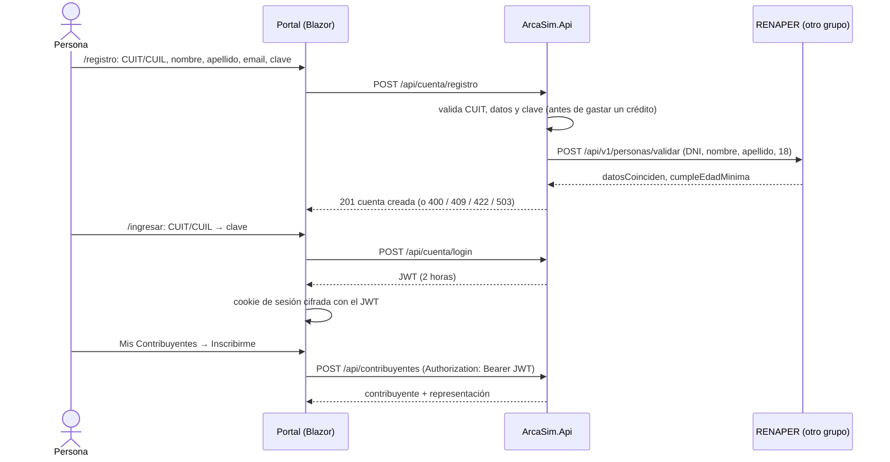

# Clave Fiscal: registro e ingreso al portal

El portal de ArcaSim se usa como el sitio de ARCA: se ingresa con **CUIT/CUIL y Clave Fiscal**, y cada
persona solo ve y opera los contribuyentes que representa.

## Cómo es en ARCA y cómo lo simulamos

| En ARCA | En ArcaSim |
|---|---|
| La Clave Fiscal la obtiene una **persona humana**. Su usuario es la CUIT/CUIL. | Igual: solo CUIT/CUIL con prefijo 20, 23, 24 o 27. |
| Para el nivel 3 se valida la identidad con **RENAPER**: en la app se escanea el DNI y se toma una selfie. Hay que ser mayor de edad. | Se valida con el RENAPER del otro grupo que el nombre y el apellido correspondan al DNI de la CUIT y que la persona tenga 18 años o más (ver [renaper.md](renaper.md)). No hay foto. |
| La clave tiene que tener entre 10 y 64 caracteres, al menos 2 números, 4 letras, 1 mayúscula y 1 minúscula. ARCA recomienda no usar datos personales. | Las mismas reglas (`ValidadorClaveFiscal`), y además la clave no puede contener la CUIT ni el DNI. |
| El ingreso tiene dos pasos: primero la CUIT/CUIL ("Siguiente") y después la clave. | Igual (`/ingresar`). |
| Tener Clave Fiscal no te inscribe: la inscripción en IVA o Monotributo es otro trámite. | Ya con la sesión iniciada, en *Mis Contribuyentes* → "Inscribirme como contribuyente". Usa los datos que validó RENAPER y no vuelve a consultarlo. |
| Las personas jurídicas no tienen clave propia: las opera una persona humana que las representa (Administrador de Relaciones). | "Alta de persona jurídica que represento": la cuenta que la da de alta queda como su representante. |
| Después de varios intentos fallidos, la clave se bloquea. ARCA no publica el número. | **5 intentos fallidos seguidos** bloquean la clave **15 minutos**, aunque después se escriba bien. Es una elección nuestra. |

No simulamos: la validación biométrica, los niveles de seguridad (todas las cuentas son "nivel 3"
porque pasan por RENAPER), el recupero de clave y la delegación de una persona jurídica a otro
representante.

## Flujo

## API

| Método | Ruta | Sesión | Respuestas |
|---|---|---|---|
| POST | `/api/cuenta/registro` | No | 201 cuenta creada · 400 datos inválidos · 409 la CUIT ya tiene cuenta · 422 RENAPER no validó · 503 RENAPER no disponible |
| POST | `/api/cuenta/login` | No | 200 `{ token, expira, usuario }` · 401 CUIT/CUIL o clave incorrectos (no dice cuál) · 423 clave bloqueada |
| GET | `/api/cuenta` | Sí | 200 datos de la cuenta y CUIT que representa |

Con sesión (`Authorization: Bearer <token>`) se usan `/api/contribuyentes` y `/api/comprobantes`.
Los listados devuelven solo los contribuyentes que representa la cuenta, y operar sobre otro CUIT
devuelve **403**. Sin token o con un token vencido o alterado, la respuesta es **401**.

No cambian: `/api/constatacion` y `/api/estado` siguen siendo públicos, y el **SOAP WSFEv1** sigue
autenticando con la API key del objeto `Auth`. Los sistemas de otros grupos no usan la Clave Fiscal.

## Cómo está hecho

- **Cuenta:** entidad `Usuario` (tabla `Usuarios`). La clave se guarda solo como hash
  PBKDF2-SHA512 con salt aleatoria (`HasheadorClavePbkdf2`).
- **Representaciones:** tabla `Representaciones` (cuenta → CUIT representado). Se crea al
  inscribirse o al dar de alta una persona jurídica.
- **Sesión en la API:** JWT firmado con HS256. El claim `sub` es la CUIT/CUIL y dura
  `Jwt:MinutosDeVigencia` (120 por defecto).
- **Sesión en el portal:** al ingresar, el portal guarda el JWT en una cookie cifrada (`ArcaSim.Sesion`,
  HttpOnly, vence junto con el token) y `ArcaSimApiCliente` lo manda en cada llamada. `/ingresar` se
  renderiza sin interactividad porque tiene que escribir la cookie. "Salir" es un POST con token
  antiforgery.

## Configuración

Sección `Jwt` de `appsettings` de la API:

| Clave | Qué es | Valor |
|---|---|---|
| `Clave` | Secreto para firmar los tokens, de 32 caracteres o más. **Nunca va en git.** | En desarrollo está en `appsettings.Development.json`. En producción se pasa con la variable de entorno `Jwt__Clave`. |
| `Emisor` / `Audiencia` | Se controlan al validar el token | `ArcaSim.Api` / `ArcaSim.Web` |
| `MinutosDeVigencia` | Duración de la sesión | `120` |

Si falta `Jwt:Clave`, la API **no arranca** (mismo criterio que `Renaper:ApiKey`).

## Cuentas de prueba

Las carga `DatosDePrueba` en desarrollo, sin pasar por RENAPER. Todas tienen la clave **`ArcaSim2026`**.

| CUIT/CUIL | Persona | Representa a |
|---|---|---|
| `27287654311` | María Ejemplo | Ella misma (monotributista) |
| `20255556666` | Pablo Demo | Comercio Demo S.A. (`30712345671`) y Fundación Demo (`30709998885`) |

Para probar el registro con el RENAPER simulado: Lucas Matias Gomez `20401112228` o Juan Carlos
Pérez `20301234563` (ver la tabla de [renaper.md](renaper.md)).
